# BlockSocial WooCommerce Sync – Anleitung

Version 3.2 · Für WordPress ab 5.8 und WooCommerce ab 5.0 (getestet bis WordPress 7.1 / WooCommerce 11.1)

Mit BlockSocial WooCommerce Sync verbindest du mehrere WooCommerce-Shops zu einem Verbund. Ein **Hauptshop**
gibt Produkte, Preise und Bestände vor. **Eigene Neben-Shops**, **Partnershops** (z. B. Dropshipping-Partner),
**Shopify-Shops** und **CSV-Abnehmer** werden automatisch beliefert. Verkäufe in jedem Shop verringern den
Bestand überall – in nahezu Echtzeit, zugeordnet über die **Artikelnummer (SKU)**.

---

## Inhalt

1. [Welches Plugin wofür?](#1-welches-plugin-wofür)
2. [Installation](#2-installation)
3. [Lizenz aktivieren](#3-lizenz-aktivieren)
4. [Hauptshop einrichten](#4-hauptshop-einrichten)
5. [Eigene Neben-Shops verbinden](#5-eigene-neben-shops-verbinden)
6. [Partnershops anbinden](#6-partnershops-anbinden)
7. [Produkt-Sync: Was wird übertragen?](#7-produkt-sync-was-wird-übertragen)
8. [Sync-Filter: Welche Produkte?](#8-sync-filter-welche-produkte)
9. [Preise anpassen](#9-preise-anpassen)
10. [Shopify anbinden](#10-shopify-anbinden)
11. [CSV-Feeds für Shops ohne Plugin](#11-csv-feeds-für-shops-ohne-plugin)
12. [Aktionen: Erstbefüllung, Abgleich, Aufräumen](#12-aktionen-erstbefüllung-abgleich-aufräumen)
13. [Updates](#13-updates)
14. [Sprachen](#14-sprachen)
15. [Häufige Fragen](#15-häufige-fragen)

---

## 1. Welches Plugin wofür?

| Plugin | Wo installieren? | Lizenzschlüssel |
|---|---|---|
| **BlockSocial WooCommerce Sync** (Admin-Plugin) | Hauptshop **und** alle eigenen Neben-Shops | nur im Hauptshop |
| **BlockSocial WooCommerce Sync – Partner** | Shops deiner Partner | keiner – über deinen Hauptshop abgedeckt |

> Admin- und Partner-Plugin nie gleichzeitig im selben Shop aktivieren.

**Lizenz und Plätze:** Jeder verbundene Shop belegt einen Platz – Hauptshop, eigene Shops, Partnershops und
Shopify-Shops. Die Lizenzstufe bestimmt, wie viele Plätze du hast (Standard 3, Premium 10, Enterprise
unbegrenzt). CSV-Feeds belegen keinen Platz.

## 2. Installation

1. Plugin-ZIP herunterladen: auf **blocksocial.eu → Mein Konto → Lizenzen → Verwalten → Downloads**.
2. In WordPress: **Plugins → Installieren → Plugin hochladen** → ZIP wählen → **Jetzt installieren** → **Aktivieren**.
3. WooCommerce muss aktiv sein. Das Plugin findest du danach unter **WooCommerce → BlockSocial Sync**
   (Partner-Plugin: **WooCommerce → BlockSocial Partner**).

Nach der Installation läuft eine **14-tägige Testphase** mit vollem Funktionsumfang – ganz ohne Schlüssel.

## 3. Lizenz aktivieren

Im **Hauptshop**: Reiter **Lizenz** → Lizenzschlüssel (`BSWS-…`) einfügen → **Aktivieren**.

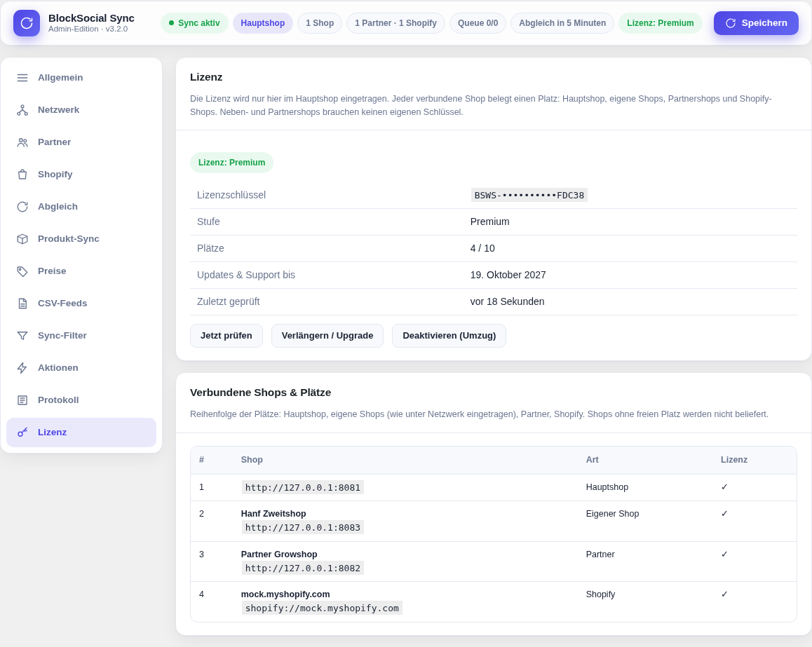

- Die Tabelle **Verbundene Shops & Plätze** zeigt, welche Shops abgedeckt sind. Die Reihenfolge: Hauptshop,
  eigene Shops (wie unter *Netzwerk* eingetragen), Partner, Shopify.
- Sind alle Plätze belegt, wird ein weiterer Shop nicht beliefert (✗ *kein Platz frei*). Ein **Upgrade** im
  Kundenkonto auf blocksocial.eu löst das sofort – du zahlst nur die Differenz.
- **Umzug** auf eine andere Domain: hier **Deaktivieren** und im neuen Hauptshop aktivieren (oder im Kundenkonto
  „Hauptshop freigeben").
- **Läuft die Lizenz ab**, synchronisiert das Plugin weiter – es gibt nur keine Updates und keinen Support mehr,
  bis du verlängerst. Ohne Lizenz nach der Testphase pausiert die Synchronisation.

In **Neben-Shops** wird kein Schlüssel eingetragen. Dort zeigt der Reiter *Lizenz*, ob der Shop über den
Hauptshop abgedeckt ist:

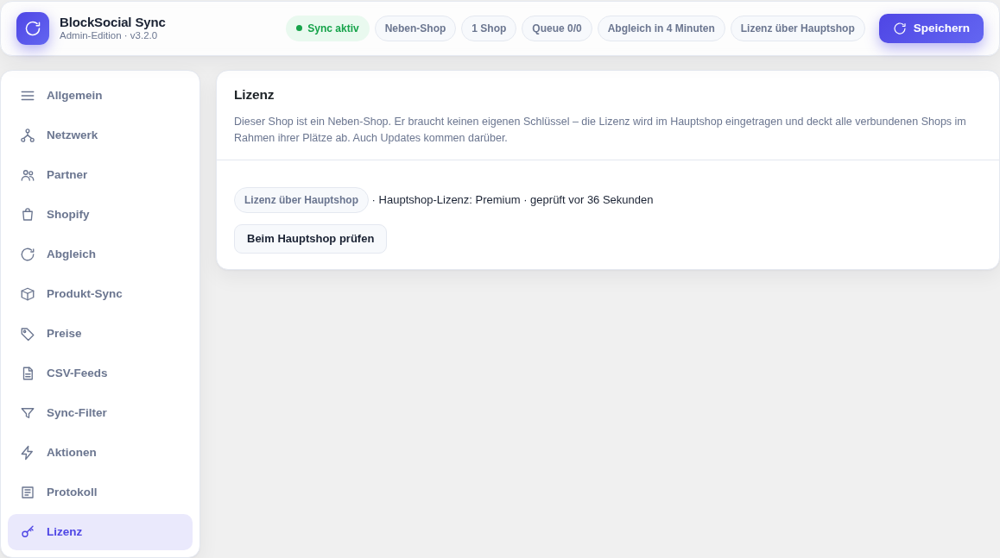

## 4. Hauptshop einrichten

Reiter **Allgemein**: Synchronisation einschalten, Shop-Name und -Adresse prüfen.

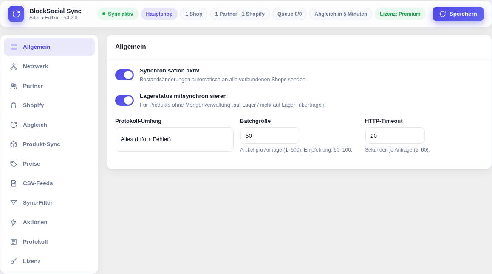

Reiter **Netzwerk**:

1. **Netzwerk-Secret** mit **Neu erzeugen** anlegen (mind. 16 Zeichen) – es wird in allen eigenen Shops
   identisch eingetragen.
2. Unter **Verbundene Shops** alle eigenen Shops eintragen (Name + Adresse), inklusive des Hauptshops selbst.
3. Unter **Hauptshop (Master)** den Hauptshop auswählen und **Speichern**.
4. Bei jedem Shop **Testen** – jeder Shop sollte mit ✓ antworten.

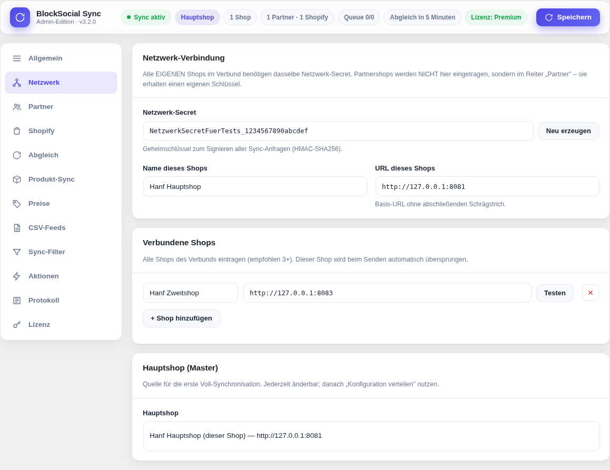

> Tipp: Mit **Aktionen → Konfiguration an alle Shops verteilen** überträgst du Shop-Liste und Hauptshop-Auswahl
> in einem Schritt an alle eigenen Shops.

## 5. Eigene Neben-Shops verbinden

In jedem Neben-Shop das Admin-Plugin installieren und unter **Netzwerk** dasselbe Secret, dieselbe Shop-Liste
und denselben Hauptshop eintragen. Danach unter **Aktionen → Produkte vom Hauptshop holen** die Erstbefüllung
starten (mit Fortschrittsbalken).

Wichtige Einstellungen im Neben-Shop (Reiter **Produkt-Sync**):

- **Produkt-Sync aktiv** – sonst werden keine Produkte angelegt.
- **Bestehende Produkte aktualisieren** / **Preise bestehender Produkte aktualisieren** – je nach Wunsch.
- **Angebotspreise übernehmen** – ausschalten, wenn der Shop eigene Angebote macht.
- **Kleinunternehmer: Preise als Brutto übernehmen** (§19 UStG) – übernimmt Preise inklusive MwSt. In diesem
  Fall in WooCommerce die Steuerberechnung deaktivieren.

## 6. Partnershops anbinden

Im Hauptshop, Reiter **Partner**:

1. Unter **Partner hinzufügen** Name, Shop-URL und Sortiment (**Gesamtes Sortiment** oder **Nur diese
   Kategorien**) eintragen → **Partner anlegen & Verbindungscode erzeugen**.
2. Den angezeigten **Verbindungscode** mit **Code kopieren** übernehmen und dem Partner geben (wie ein Passwort
   behandeln). Später jederzeit über **Code anzeigen** abrufbar.
3. Unter **Vorgaben für alle Partner** festlegen, was Partner dürfen: z. B. eigene Preisaufschläge in einem
   Rahmen (min./max. %), nur Bestandsverringerung durch Verkäufe usw.

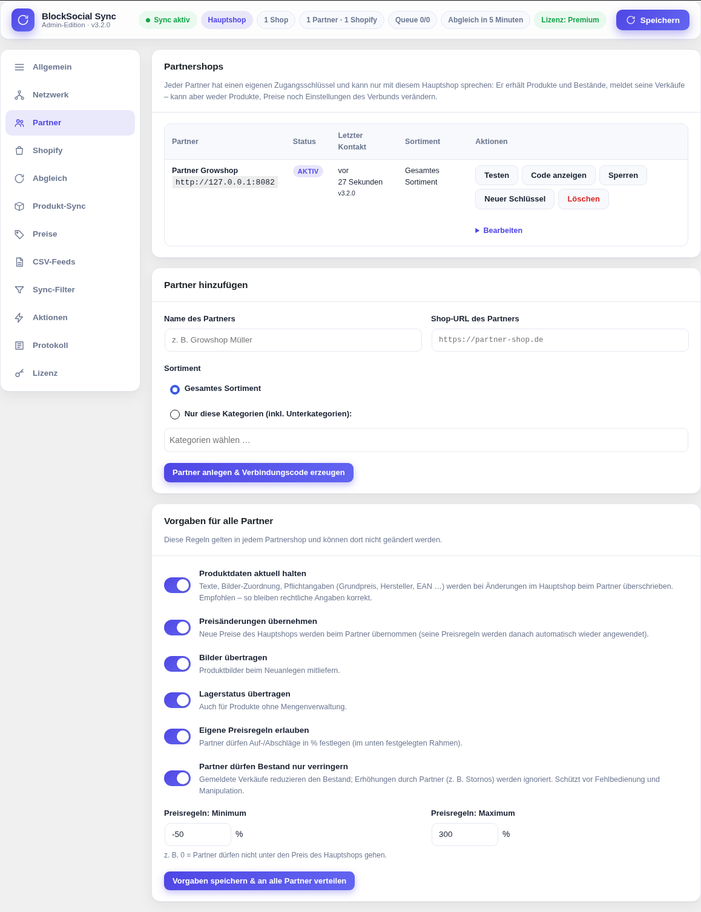

Der **Partner** installiert das Partner-Plugin, fügt den Code unter **Verbindung** ein und klickt **Verbinden**:

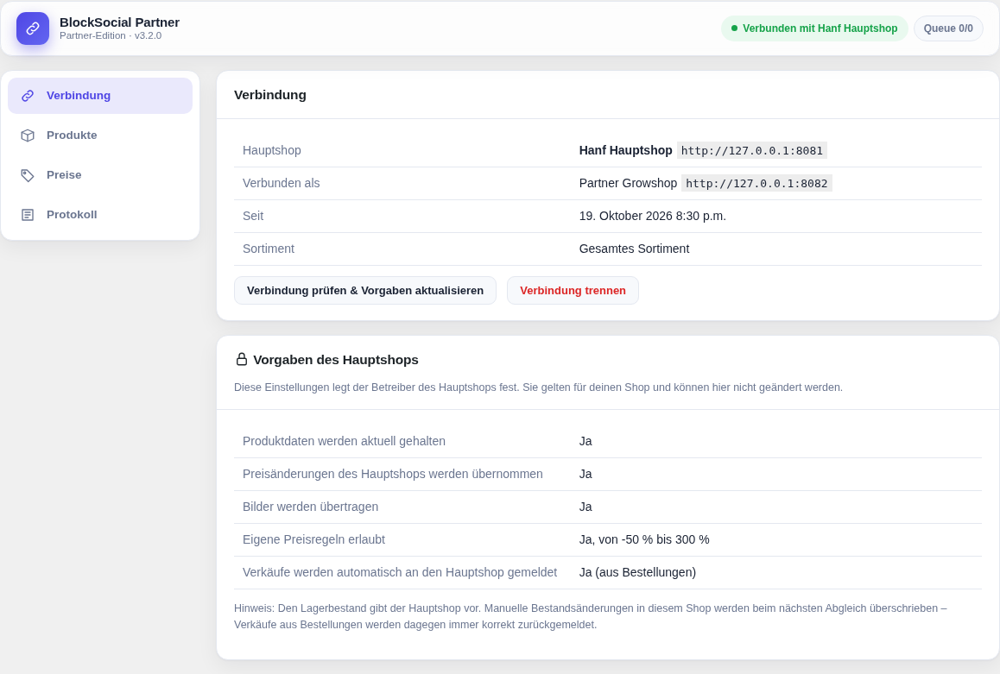

Danach holt er unter **Produkte** alle freigegebenen Produkte:

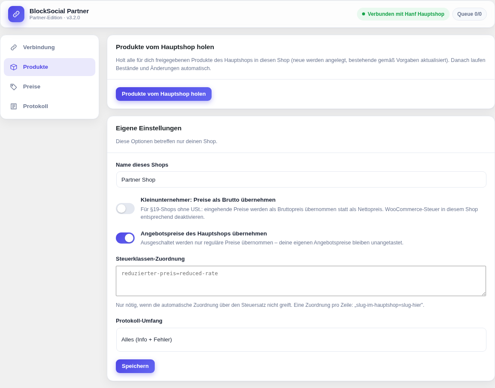

Verkäufe beim Partner werden automatisch an den Hauptshop gemeldet (als Verkaufsmenge, nicht als Absolutwert –
dadurch gehen keine Verkäufe verloren). Alles, was du vorgibst, ist beim Partner schreibgeschützt.

## 7. Produkt-Sync: Was wird übertragen?

Reiter **Produkt-Sync**: Neue Produkte werden 1:1 übertragen – Texte, Bilder, Kategorien, Schlagwörter, Marken,
Attribute, Hersteller-Angaben, EAN/GTIN, Versandklasse, Lieferzeit, Germanized-Grundpreis, Maße, Status und
Bestand. Jedes Feld lässt sich einzeln an- und abwählen, regulärer Preis und Angebotspreis getrennt.

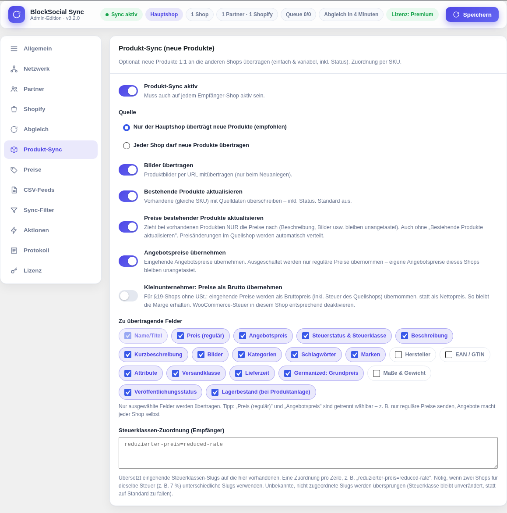

## 8. Sync-Filter: Welche Produkte?

Jeder Shop legt fest, welche Produkte er **sendet und empfängt**:

- **Alle Produkte** oder **Nur ausgewählte** (nach Kategorie, Marke oder Einzelprodukt).
- **Kategorien ausschließen** – inklusive aller Unterkategorien.
- **Ausnahmen vom Kategorie-Ausschluss (Marken)** – z. B. „Growshop" ausschließen, außer Marke „Spider Farmer".
- **Kategorien ignorieren** – z. B. „Angebote": zählt weder für Auswahl noch Ausschluss und wird nicht
  übertragen.
- **Vorschau: Umfang anzeigen** zeigt vor dem Speichern, wie viele Produkte betroffen sind.

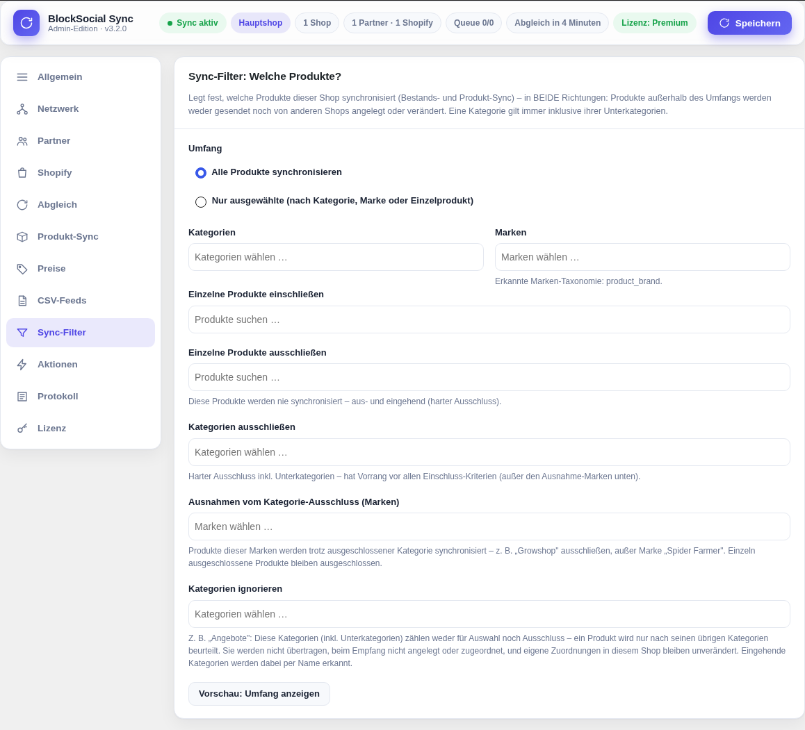

Maßgeblich ist immer der Kategoriebaum **des eigenen Shops**: Ein eingehendes Produkt wird danach beurteilt, in
welcher Kategorie es hier liegt bzw. landen würde.

## 9. Preise anpassen

Empfänger-Shops (Neben- und Partnershops) können Preise **nach dem Einspielen** anpassen: in Prozent nach oben
oder unten, für alle Produkte oder je Kategorie, optional mit Rundung (z. B. auf ,99). Die Regeln bleiben bei
Preis-Updates des Hauptshops erhalten – es wird nie „Aufschlag auf Aufschlag" gerechnet.

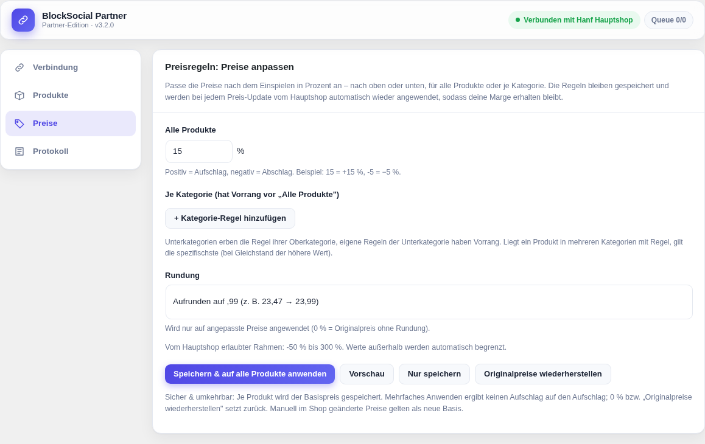

Partner können Preise nur im Rahmen anpassen, den du im Hauptshop vorgibst.

## 10. Shopify anbinden

Im Hauptshop, Reiter **Shopify** → **Shopify-Shop hinzufügen**:

1. In Shopify im **Dev Dashboard** eine App anlegen (Scopes: Produkte, Inventar, Standorte lesen/schreiben).
2. **Client-ID** und **Client-Secret** eintragen (alternativ ein Admin-API-Token `shpat_…`).
3. Bestände und/oder Produkte aktivieren, Status für neue Produkte und Preisregeln wählen → **Speichern**.
4. **Verbindung testen**, dann **Übertragung starten**.

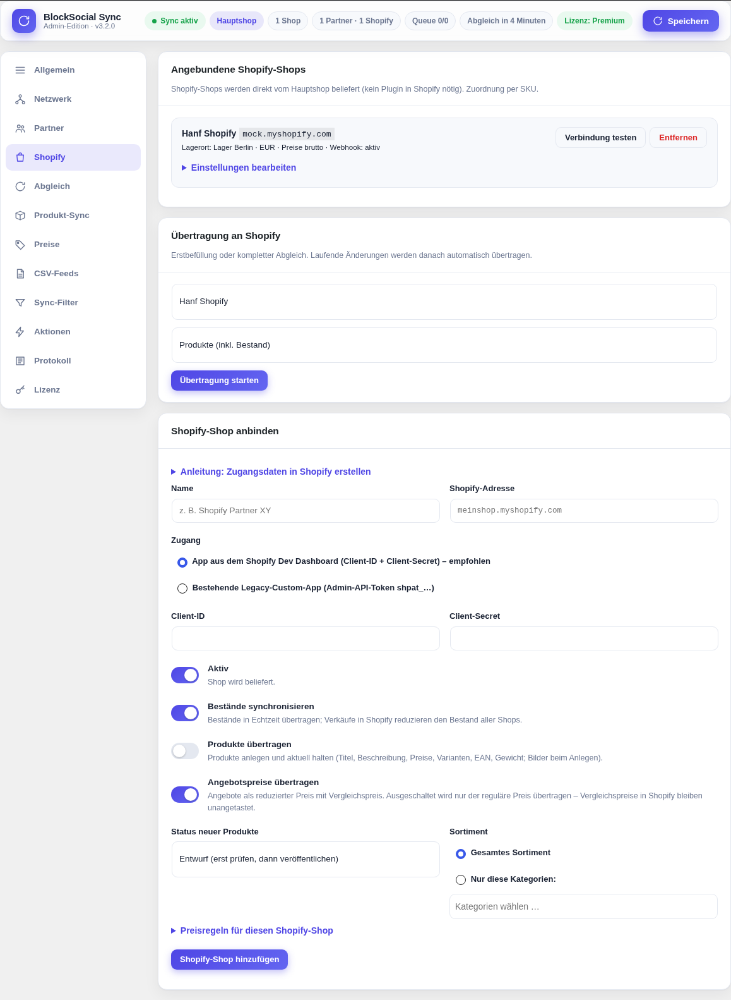

Verkäufe in Shopify werden per Webhook zurückgemeldet und verringern den Bestand im ganzen Verbund.

## 11. CSV-Feeds für Shops ohne Plugin

Reiter **CSV-Feeds**: Feed anlegen (Preise brutto/netto, Trennzeichen, nur verfügbare Produkte, eigene
Preisregeln …). Jeder Feed hat eine **geheime Abruf-URL**, die z. B. ein Marktplatz oder ein Shop-System
regelmäßig abruft. Der Feed aktualisiert sich automatisch, sobald sich Bestand oder Preis ändern.

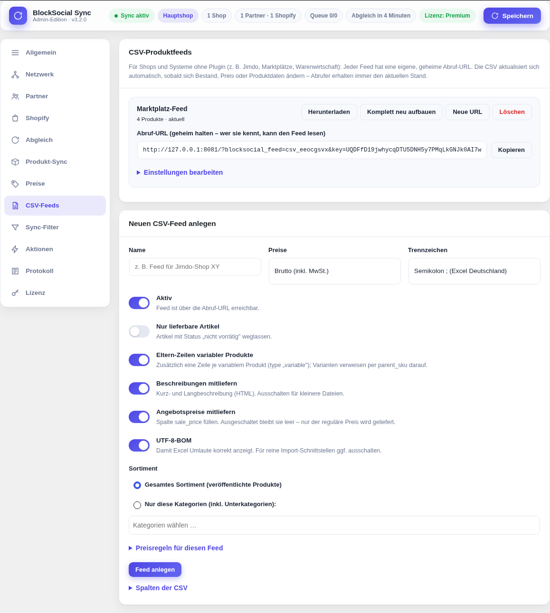

## 12. Aktionen: Erstbefüllung, Abgleich, Aufräumen

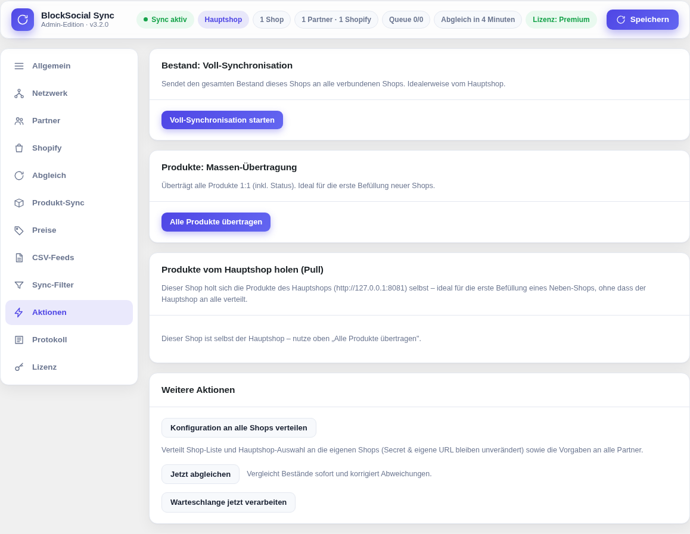

- **Bestand: Voll-Synchronisation** – sendet alle Bestände des Hauptshops an alle Shops.
- **Produkte: Massen-Übertragung** – überträgt alle Produkte an alle Shops (Erstbefüllung vom Hauptshop aus).
- **Produkte vom Hauptshop holen** – Erstbefüllung vom Neben-Shop aus.
- **Abgleich** (Reiter *Abgleich*) – prüft regelmäßig alle Bestände und korrigiert Abweichungen.
- **Aufräumen** (Neben-Shops) – findet übertragene Produkte, die nicht (mehr) in den Sync-Filter passen, zeigt
  Gründe und Kategorien und verschiebt sie in den Papierkorb oder löscht sie endgültig inkl. Bilder. Eigene
  Produkte, deren SKU es im Hauptshop nicht gibt, werden nie angefasst.

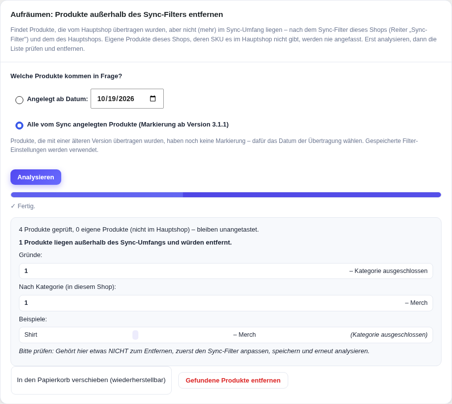

## 13. Updates

Updates erscheinen wie gewohnt unter **Dashboard → Aktualisierungen** und können per Klick oder automatisch
installiert werden – im Hauptshop, in allen Neben-Shops und bei Partnern. Voraussetzung ist eine aktive Lizenz.

## 14. Sprachen

Die Oberfläche ist verfügbar auf **Deutsch, Englisch, Französisch, Spanisch, Italienisch, Niederländisch und
Polnisch**. Sie richtet sich nach der Sprache der Website bzw. des Benutzerprofils. Regionale Varianten
(z. B. Englisch (UK), Französisch (Schweiz), Spanisch (Mexiko)) nutzen automatisch die passende Sprache.
Jeder Benutzer kann seine Sprache unter **Benutzer → Profil → Sprache** selbst wählen.

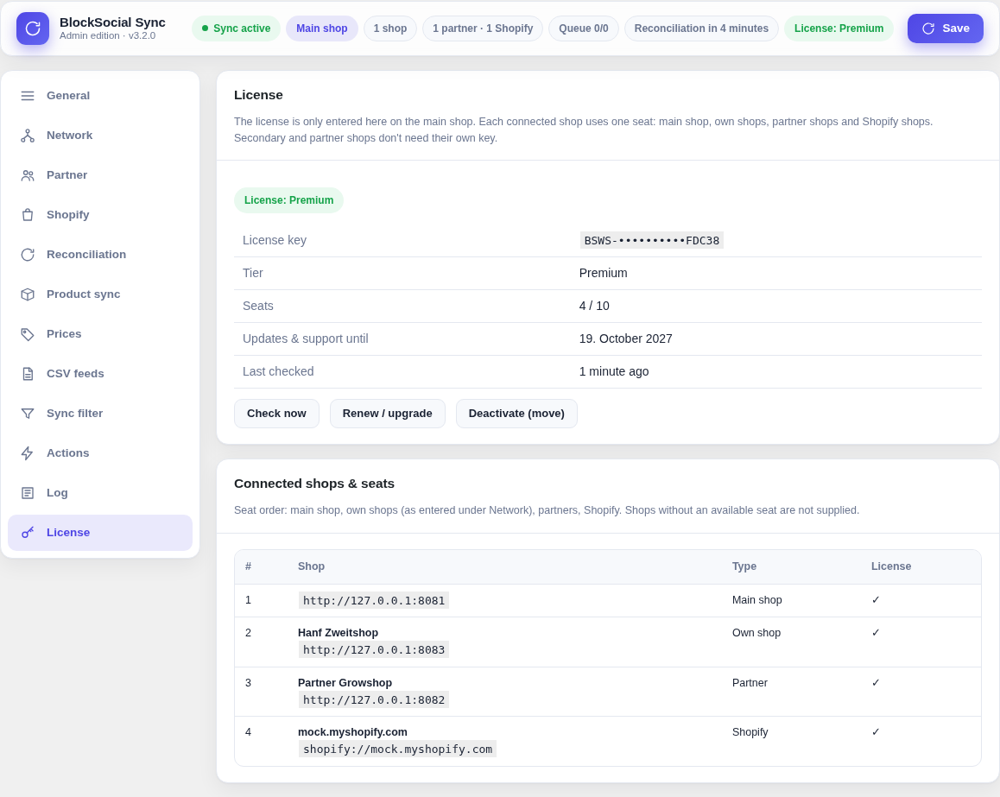

## 15. Häufige Fragen

**Wie werden Produkte zugeordnet?** Über die Artikelnummer (SKU). Produkte ohne SKU werden nicht synchronisiert
(variable Produkte auch über die SKUs ihrer Varianten).

**Was passiert, wenn ein Shop kurz offline ist?** Änderungen landen in einer Warteschlange und werden
automatisch nachgereicht. Der regelmäßige Abgleich korrigiert verbleibende Abweichungen.

**Kann ein Partner meine Preise oder Produkte verändern?** Nein. Partner haben einen eigenen Schlüssel, sprechen
nur mit deinem Hauptshop und melden ausschließlich Verkäufe. Alles andere ist schreibgeschützt.

**Ist die Verbindung sicher?** Alle Anfragen sind mit HMAC-SHA256 signiert, mit Zeitstempel gegen
Wiederholung geschützt und laufen über HTTPS.

**Ich brauche mehr Shops.** Upgrade im Kundenkonto auf blocksocial.eu – du zahlst nur die Differenz, der
Schlüssel bleibt gleich.

**Support:** über blocksocial.eu (in der Lizenzlaufzeit enthalten).
