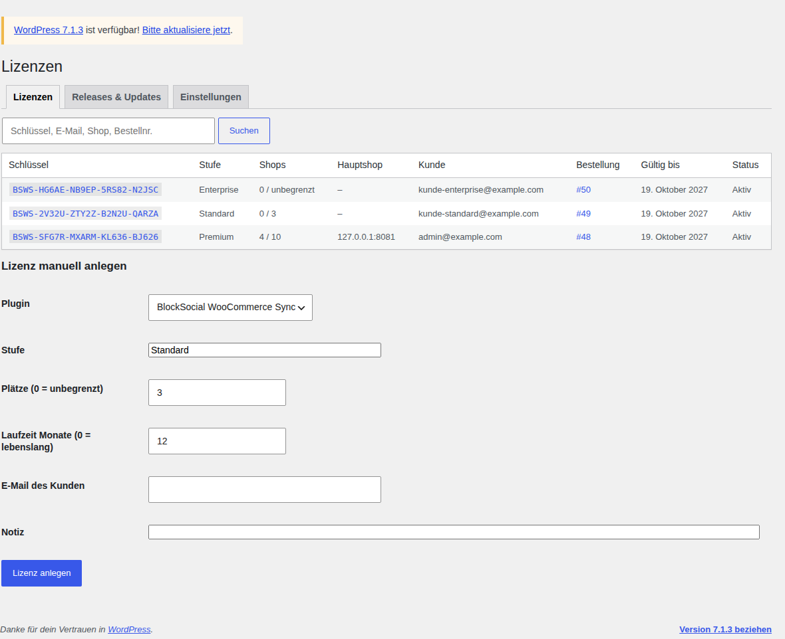
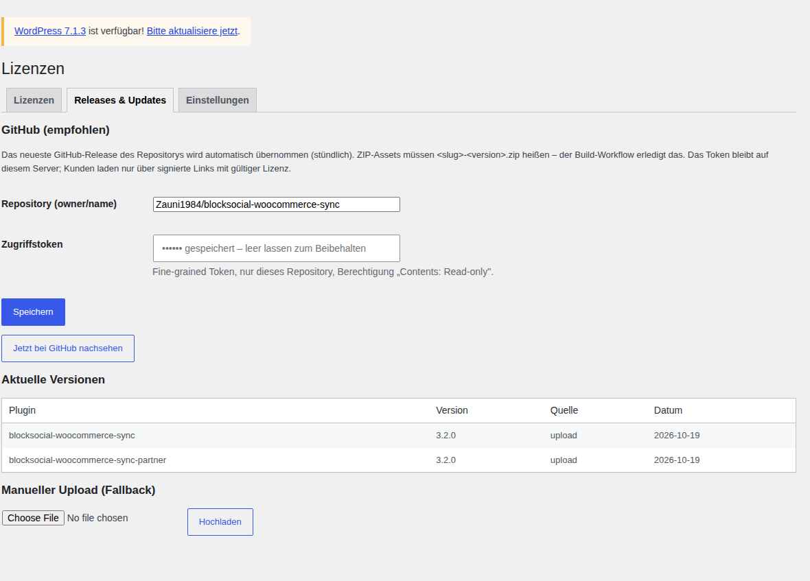
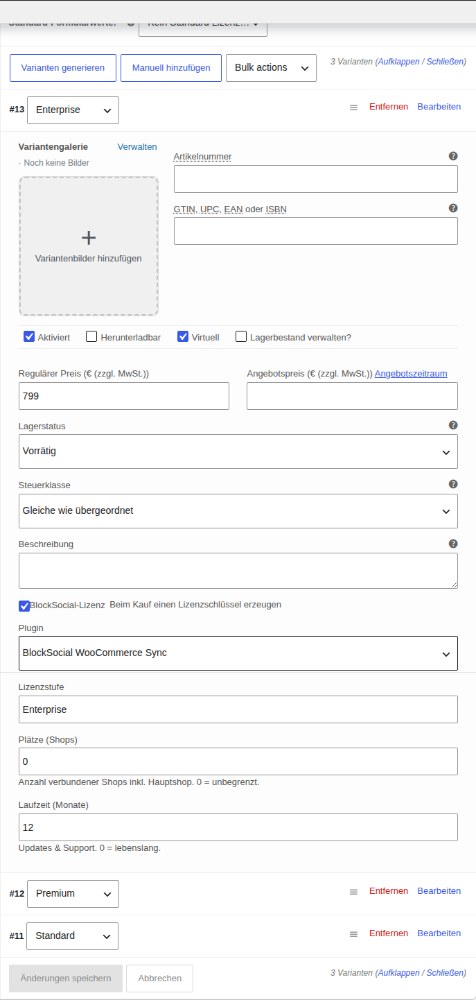
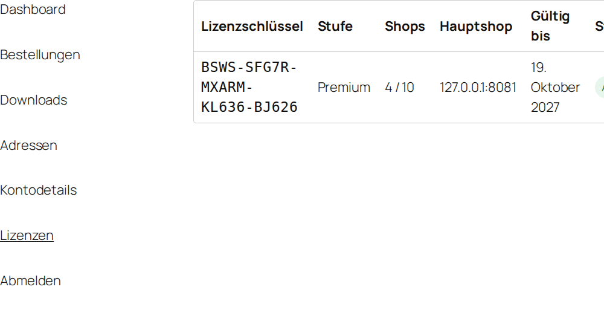
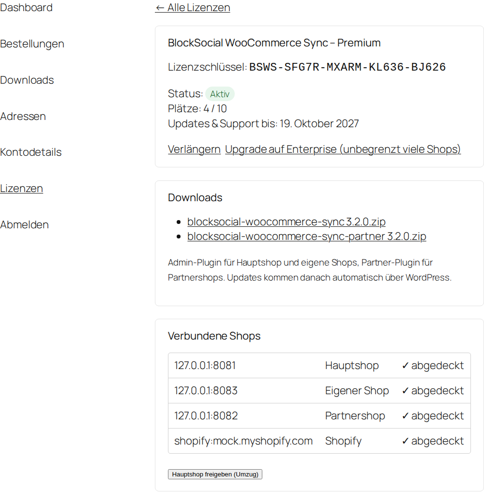
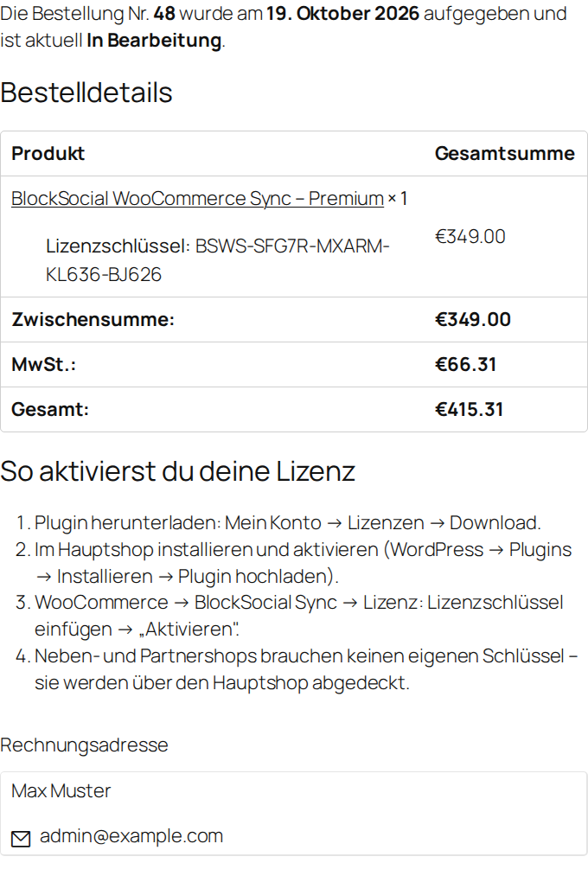

# Verkauf über blocksocial.eu – Einrichtung, Preise, Texte

Dieses Dokument beschreibt, wie die Plugins über WooCommerce auf **blocksocial.eu** verkauft werden: Lizenzmodell,
Preisvorschlag, Einrichtung des Lizenzservers, Produkt-Anlage, Release-Ablauf und Produkttexte.

---

## 1. Lizenzmodell

| | **Standard** | **Premium** | **Enterprise** |
|---|---|---|---|
| Verbundene Shops (Plätze) | bis 3 | bis 10 | unbegrenzt |
| Laufzeit Updates & Support | 12 Monate | 12 Monate | 12 Monate |
| Alle Funktionen (Partner, Shopify, CSV, Preisregeln, Filter) | ✓ | ✓ | ✓ |
| Partner-Plugin für Partnershops | ✓ | ✓ | ✓ |

**Plätze** = verbundene Shops: Hauptshop + eigene Shops + Partnershops + Shopify-Shops. CSV-Feeds zählen nicht.
Der Lizenzschlüssel wird **nur im Hauptshop** eingetragen; Neben- und Partnershops sind darüber abgedeckt und
erhalten darüber auch ihre Updates.

**Verhalten im Plugin**

- **14 Tage Testphase** ab Installation, voller Funktionsumfang, ohne Schlüssel.
- **Plätze voll:** Shops über dem Limit werden nicht beliefert (die zuletzt hinzugefügten). Der Hauptshop zeigt
  das deutlich an und verlinkt zum Upgrade.
- **Lizenz abgelaufen:** Die Synchronisation läuft **weiter** (kein Überverkaufs-Risiko für Kunden), aber ohne
  Updates und Support bis zur Verlängerung.
- **Erstattung/Storno:** Lizenz wird automatisch widerrufen; nach der Testphase pausiert die Synchronisation.
- **Umzug:** Kunde deaktiviert im alten Hauptshop oder gibt den Hauptshop im Kundenkonto frei.

### Warum dieses Modell (Vorschläge, die schon umgesetzt sind)

1. **Plätze statt Installationen** – ein Partnershop braucht keinen eigenen Schlüssel. Das ist ein starkes
   Verkaufsargument für Dropshipping-/B2B-Betreiber („Bindet eure Partner ohne Zusatzkosten an") und verhindert,
   dass Schlüssel an Partner weitergegeben werden.
2. **Weiterlaufen nach Ablauf** – Bestands-Sync ist geschäftskritisch. Ein harter Stopp würde zu Überverkäufen
   führen und Vertrauen kosten. Der Anreiz zur Verlängerung kommt über Updates, Support und neue
   WordPress/WooCommerce-Versionen.
3. **Upgrade zum Differenzpreis** – der Kunde zahlt beim Wechsel nur den Unterschied, Schlüssel und Laufzeit
   bleiben.
4. **Verlängerungsrabatt** – im Lizenzserver einstellbar (Empfehlung 25 %), senkt die Abwanderung.
5. **Testphase im Plugin statt Demo-Shop** – Kunden testen mit ihren eigenen Shops.

### Weitere Ideen (optional, noch nicht umgesetzt)

- **Lebenslange Lizenz** als vierte Option zum ca. 2,5-fachen Jahrespreis (im Lizenzserver bereits möglich:
  Laufzeit 0 = lebenslang).
- **Agentur-Lizenz**: Enterprise mit mehreren Hauptshops (mehrere Schlüssel zum Paketpreis – Menge > 1 im
  Warenkorb erzeugt automatisch mehrere Schlüssel).
- **Einrichtungsservice** als separates Produkt (z. B. 199 €), da Ersteinrichtung mit Partnern/Shopify Zeit
  kostet.

## 2. Preisvorschlag

| Stufe | Preis netto / Jahr | Verlängerung (−25 %) | Upgrade von Standard |
|---|---|---|---|
| **Standard** (bis 3 Shops) | **149 €** | 111,75 € | – |
| **Premium** (bis 10 Shops) | **349 €** | 261,75 € | 200 € |
| **Enterprise** (unbegrenzt) | **799 €** | 599,25 € | 650 € (von Premium: 450 €) |

**Begründung:** Einzelplatz-Plugins für WooCommerce liegen typischerweise bei 29–99 €/Jahr, Agentur- bzw.
unbegrenzte Lizenzen bei 150–400 €/Jahr. Dieses Plugin ist ein Mehr-Shop-Werkzeug mit Partner-/Dropshipping-
Funktionen, Shopify-Anbindung und CSV-Feeds und ersetzt manuelle Bestandsarbeit in mehreren Shops – das
rechtfertigt den oberen Bereich. Standard (149 €) entspricht etwa 4 € pro Shop und Monat, Premium (349 €) etwa
3 €, Enterprise lohnt sich ab ca. 20 Shops. Konkrete Preise vergleichbarer Mehr-Shop-Sync-Plugins konnte ich nicht
verifizieren – bitte vor dem Start kurz gegenprüfen.

Preise als Nettopreise (B2B) ausweisen; für Endkunden zzgl. MwSt.

## 3. Lizenzserver auf blocksocial.eu einrichten

Voraussetzungen: WordPress mit WooCommerce auf blocksocial.eu, PHP 7.4+ mit `zip`-Erweiterung, HTTPS.

1. **Plugin installieren:** `blocksocial-license-server-1.0.0.zip` hochladen und aktivieren.
   (Danach **Einstellungen → Permalinks → Speichern**, damit „Mein Konto → Lizenzen" erreichbar ist.)
2. **GitHub-Anbindung** (WooCommerce → Lizenzen → *Releases & Updates*):
   - Repository: `Zauni1984/blocksocial-woocommerce-sync`
   - Zugriffstoken: auf GitHub unter *Settings → Developer settings → Fine-grained tokens* ein Token
     **nur für dieses Repository** mit **Contents: Read-only** anlegen und eintragen.
   - **Jetzt bei GitHub nachsehen** → die aktuellen Versionen beider Plugins erscheinen in der Tabelle.
3. **Einstellungen:** Rabatt auf Verlängerungen eintragen (Empfehlung 25 %).
4. **Produkt anlegen** (siehe 4.).
5. **Eigene Lizenz für hanfjack.de anlegen:** WooCommerce → Lizenzen → *Lizenz manuell anlegen* (z. B. Enterprise,
   Plätze 0, Laufzeit 0 = lebenslang) und im Hauptshop eintragen. Ohne Lizenz pausiert die Synchronisation in
   den eigenen Shops 14 Tage nach dem Update auf 3.2.0.





## 4. Produkt in WooCommerce anlegen

Empfohlen: **ein variables Produkt** „BlockSocial WooCommerce Sync" mit dem Attribut **Lizenz**
(Standard | Premium | Enterprise).

- Produkt: **Virtuell** (kein Versand). Nicht als „Herunterladbar" markieren – Downloads und Updates liefert
  der Lizenzserver (immer die aktuelle Version).
- Je Variante im Abschnitt **BlockSocial-Lizenz**: Haken setzen, Plugin wählen, Lizenzstufe, **Plätze**
  (3 / 10 / 0 = unbegrenzt), **Laufzeit** 12 Monate.
- Preise je Variante setzen.



Nach dem Kauf erhält der Kunde den Schlüssel in der Bestellbestätigung und unter **Mein Konto → Lizenzen**:







Lizenzen werden erzeugt, sobald die Bestellung **bezahlt** ist (Status „In Bearbeitung" oder „Abgeschlossen").
Bei **Erstattet** oder **Storniert** werden sie automatisch widerrufen.

## 5. Neue Version veröffentlichen (automatische Updates)

1. Version erhöhen in `includes/bootstrap.php` (`WCIS_VERSION`), in beiden Plugin-Hauptdateien (`Version:`),
   in `readme.txt` und `partner/readme.txt` (`Stable tag:` + Changelog-Eintrag).
2. Committen und pushen, dann einen Tag setzen:
   ```
   git tag v3.2.1
   git push origin v3.2.1
   ```
3. Die GitHub Action **Release** baut beide ZIPs, prüft die PHP-Syntax und legt das GitHub-Release an.
4. Der Lizenzserver übernimmt das Release spätestens nach einer Stunde (sofort: *Jetzt bei GitHub nachsehen*).
5. Alle lizenzierten Shops sehen das Update unter **Dashboard → Aktualisierungen** (Prüfung alle ~12 Stunden).

Der Token bleibt auf blocksocial.eu. Kunden laden ausschließlich über zeitlich begrenzte, signierte Links und nur
mit aktiver Lizenz – das GitHub-Repository kann (und sollte) **privat** sein.

## 6. Produkttexte für den Shop

### Kurzbeschreibung

> **Ein Lager, viele Shops.** BlockSocial WooCommerce Sync hält Bestände, Produkte und Preise zwischen deinen
> WooCommerce-Shops, Partnershops und Shopify automatisch synchron – in Echtzeit, über die Artikelnummer.
> Kein Überverkauf, keine doppelte Pflege. 14 Tage kostenlos testen.

### Beschreibung

**Für wen?** Händler mit mehreren Shops, Marken mit Vertriebspartnern, Dropshipping- und B2B-Anbieter.

**Bestände in Echtzeit:** Jeder Verkauf – im Hauptshop, in einem Neben-Shop, bei einem Partner oder in
Shopify – verringert den Bestand überall. Fällt ein Shop kurz aus, wird automatisch nachgereicht; ein
regelmäßiger Abgleich korrigiert Abweichungen.

**Produkte 1:1 übertragen:** Texte, Bilder, Kategorien, Marken, Attribute, Varianten, EAN/GTIN, Hersteller,
Lieferzeit, Germanized-Grundpreis, Versandklasse – jedes Feld einzeln wählbar, regulärer Preis und Angebotspreis
getrennt.

**Partner sicher anbinden:** Jeder Partner erhält einen eigenen Verbindungscode und das Partner-Plugin. Er
bekommt dein Sortiment (ganz oder nach Kategorien) und meldet Verkäufe zurück – kann aber nichts an deinen
Vorgaben ändern. Partner brauchen keine eigene Lizenz.

**Eigene Preise je Shop:** Auf- oder Abschläge in Prozent, für alle Produkte oder je Kategorie, mit Rundung auf
,99. Für Partner im von dir erlaubten Rahmen.

**Shopify & CSV:** Shopify-Shops per offizieller Admin-API anbinden. Shops ohne Plugin (Marktplätze, andere
Systeme) per automatisch aktualisiertem CSV-Feed beliefern.

**Präzise Sortimentssteuerung:** Kategorien und Marken ein- oder ausschließen, Ausnahmen festlegen, Kategorien
wie „Angebote" ignorieren – in beide Richtungen wirksam. Ein Aufräum-Werkzeug entfernt falsch übertragene
Produkte mit Vorschau.

**Sicher & mehrsprachig:** HMAC-signierte Verbindungen, Schutz gegen Wiederholung. Oberfläche auf Deutsch,
Englisch, Französisch, Spanisch, Italienisch, Niederländisch und Polnisch.

**Lizenz:** Plätze = verbundene Shops. Standard bis 3, Premium bis 10, Enterprise unbegrenzt. 12 Monate Updates &
Support; die Synchronisation läuft auch nach Ablauf weiter. Upgrade jederzeit zum Differenzpreis.

**Voraussetzungen:** WordPress 5.8+, WooCommerce 5.0+, PHP 7.4+, HTTPS. Getestet bis WordPress 7.1 / WooCommerce 11.1.

### FAQ für die Produktseite

- **Brauchen meine Partner eine eigene Lizenz?** Nein, sie belegen einen Platz deiner Lizenz.
- **Was passiert nach 12 Monaten?** Die Synchronisation läuft weiter. Für Updates und Support verlängerst du
  zum reduzierten Preis.
- **Kann ich später aufstocken?** Ja, jederzeit im Kundenkonto – du zahlst nur die Differenz.
- **Kann ich vorher testen?** Ja, 14 Tage mit vollem Funktionsumfang direkt nach der Installation.
- **Kann ich die Lizenz auf einen anderen Hauptshop umziehen?** Ja, mit einem Klick im Plugin oder im Kundenkonto.

## 7. Vor dem Verkaufsstart prüfen

- [ ] Beide GitHub-Repositories auf **privat** stellen (`blocksocial-woocommerce-sync` und
      `18plus-Cannabis-Shop-Popup`, das den Plugin-Code ebenfalls enthält).
- [ ] **Lizenztext klären:** Das Plugin steht derzeit unter **MIT**. Damit dürfte jeder Käufer den Code
      weitergeben. Für den Verkauf üblich ist GPL-2.0-or-later (WordPress-Standard; Verkauf von Schlüsseln für
      Updates/Support) oder eine eigene kommerzielle Lizenz (EULA). Bitte rechtlich entscheiden.
- [ ] AGB, Widerrufsbelehrung für digitale Inhalte (Zustimmung zum vorzeitigen Erlöschen des Widerrufsrechts im
      Checkout), Datenschutzhinweis zum Lizenzserver (übermittelt werden Shop-Adressen und Plugin-Version).
- [ ] Eigene Lizenz für hanfjack.de/hanfjack.com/moinkiffers.de anlegen und aktivieren (siehe 3.5).
- [ ] Testkauf mit echtem Zahlungsanbieter durchführen.
- [ ] Ersten Release-Tag `v3.2.0` setzen, damit der Lizenzserver Downloads anbieten kann.
